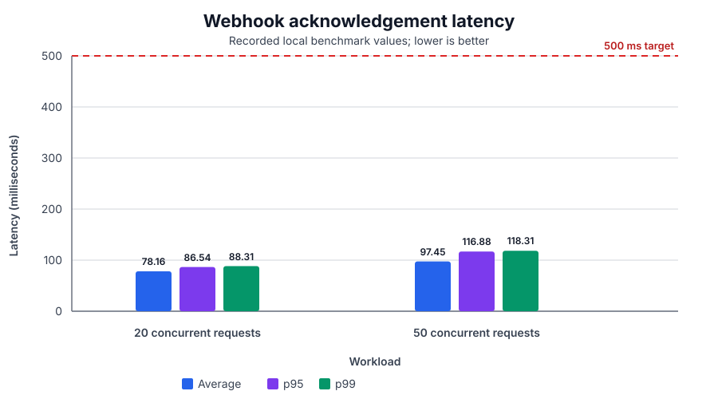

# Transaction Webhook Processing Service

_Reliable, asynchronous and idempotent payment webhook processing using FastAPI, PostgreSQL, Redis and Celery._

This service accepts transaction webhooks, durably records them, and processes them asynchronously. The endpoint returns an acknowledgement after PostgreSQL commits both the transaction and its processing intent. An outbox dispatcher then publishes the work to Redis/Celery, and a worker performs the simulated 30-second operation.

Fast webhook acknowledgement matters because payment providers retry slow or lost requests. Duplicate deliveries are normal, so repeated submissions must be safe. Durable persistence matters because accepted work must survive API, broker, dispatcher, and worker restarts. This design addresses those requirements with a transactional outbox, database-enforced idempotency, worker leases, and stale-worker fencing.

This repository implements the Senior Full Stack Developer transaction-webhook assessment. The personal GitHub repository is [Transaction-Webhook-Processing-Service](https://github.com/akshaychavan23031998/Transaction-Webhook-Processing-Service); Vercel cloud deployment is prepared but not yet claimed as successful.

## Status at a glance

Local verification was completed on **2026-10-20**. The final Compose stack passed the recorded API, end-to-end, concurrency, persistence, recovery, lint, migration, and benchmark checks in [docs/VERIFICATION_REPORT.md](docs/VERIFICATION_REPORT.md).

The remaining local development gaps are in [docs/PENDING_TASKS.md](docs/PENDING_TASKS.md). GitHub publication is complete; Vercel deployment and provider resource setup still require manual verification.

## Table of contents

- [Project highlights](#project-highlights)
- [Assignment requirements and compliance](#assignment-requirements-and-compliance)
- [Architecture](#architecture)
- [Idempotency and reliability](#idempotency-and-reliability)
- [Database and data model](#database-and-data-model)
- [Local setup](#local-setup)
- [API reference](#api-reference)
- [Automated testing](#automated-testing)
- [Verified performance](#verified-performance)
- [Vercel Hobby deployment](#vercel-hobby-deployment)
- [Reliability evidence](#reliability-evidence)
- [Observability and operations](#observability-and-operations)
- [Security considerations](#security-considerations)
- [Architectural decisions](#architectural-decisions)
- [Known limitations and future improvements](#known-limitations-and-future-improvements)
- [Assessment handoff](#assessment-handoff)

## Project highlights

Implemented and locally verified:

- Fast HTTP 202 acknowledgement after durable PostgreSQL acceptance.
- PostgreSQL transaction storage with exact NUMERIC money storage and UTC timestamps.
- Atomic transaction plus transactional-outbox insertion.
- Redis-backed Celery processing.
- Database-enforced transaction ID uniqueness.
- Identical duplicate acknowledgement and conflicting-payload rejection.
- Concurrent duplicate protection and duplicate Celery-task protection.
- Worker leases, attempts, fencing tokens, and expired-lease recovery.
- Transaction status API with processing and completion timestamps.
- Structured JSON logs for API, worker, and dispatcher events.
- Docker Compose for PostgreSQL, Redis, migrations, API, worker, and dispatcher.
- Alembic migration checks, pytest coverage, Ruff checks, E2E, concurrency, and benchmark scripts.
- Local Redis, PostgreSQL, API, dispatcher, worker-crash, and lease-recovery verification.

The current local gaps are a repeatable automated live-failure suite and provider-specific HMAC verification once the real provider contract is supplied. Vercel deployment remains an unverified manual delivery step.

## Assignment requirements and compliance

| Requirement | Expected behavior | Implementation | Verification | Result |
|---|---|---|---|---|
| Webhook endpoint | Accept transaction webhook | POST /v1/webhooks/transactions | API and E2E checks | **Verified** |
| Health check | Current healthy status and UTC time | GET / | Direct API check | **Verified** |
| Readiness check | Report database and broker readiness | GET /ready | Healthy and dependency-failure checks | **Verified** |
| Transaction query | Retrieve one transaction | GET /v1/transactions/{transaction_id} | Processing, processed, and 404 checks | **Verified** |
| HTTP 202 | Acknowledge without waiting 30 seconds | Atomic database acceptance, async worker | E2E and benchmark | **Verified** |
| 500 ms target | Healthy local acknowledgement under target | No worker wait in HTTP path | 20 and 50 concurrent runs | **Verified locally** |
| 30-second processing | Background work completes after about 30 seconds | Configurable Celery delay, default 30 | Worker timestamps and DB state | **Verified** |
| Duplicate prevention | No second transaction or unsafe completion | Unique key, payload match, leases, fencing | Sequential, concurrent, task, replay tests | **Verified** |
| Durable storage | Do not acknowledge uncommitted work | Transaction and outbox atomic commit | PostgreSQL audit and outage test | **Verified** |
| Concurrency | Protect requests and worker claims | Locks, skip-locked claims, tokens | 20 duplicate and 50 unique requests | **Verified** |
| Error handling | Useful validation, conflict, dependency responses | 409/422/503 handling and retries | API and recovery checks | **Verified** |
| Crash recovery | Resume incomplete work | Outbox retry and lease-expiry sweep | Dependency and process drills | **Verified locally** |
| GitHub repository | Publish assessment repository | Personal repository exists at the linked GitHub URL | Remote publication is a separate handoff concern | **Published** |
| Cloud deployment | Deploy public service | Vercel configuration is prepared; no cloud deployment was run by this audit | Requires manual Vercel/provider setup and verification | **Pending** |

## Architecture

### High-level architecture

The synchronous path validates and durably accepts the webhook. The asynchronous path dispatches and processes it later.

~~~mermaid
flowchart LR
    Sender[External webhook sender]
    API[FastAPI API validation and response]
    DB[(PostgreSQL transactions + outbox)]
    Dispatcher[Outbox dispatcher]
    Redis[(Redis broker)]
    Worker[Celery worker claim + 30s processing]
    Query[Transaction status API]

    Sender -->|POST webhook| API
    API -->|atomic insert| DB
    API -->|202 Accepted| Sender
    DB -->|pending event| Dispatcher
    Dispatcher -->|publish task| Redis
    Redis --> Worker
    Worker -->|lease-guarded update| DB
    Query -->|read status| DB
~~~

~~~mermaid
flowchart TB
    subgraph Synchronous[HTTP request path]
        A[Receive webhook] --> B[Validate Pydantic payload]
        B --> C[Insert transaction and outbox atomically]
        C --> D[Return 202]
    end
    subgraph Asynchronous[Background path]
        E[Dispatcher claims event] --> F[Celery task in Redis]
        F --> G[Worker claims lease]
        G --> H[Simulated 30-second processing]
        H --> I[Conditional PROCESSED update]
    end
    C -. durable handoff .-> E
    D -. response is already complete .-> E
~~~

### Component responsibilities

| Component | Responsibility | Why it is needed |
|---|---|---|
| External sender | Sends notifications and may retry | Slow or lost acknowledgements cause retries |
| FastAPI | Health, readiness, webhook, and status endpoints | Defines the HTTP boundary and validation contract |
| Pydantic schemas | Validates IDs, accounts, amount, currency, and extra fields | Rejects malformed input early |
| Transaction service | Applies duplicate and conflict policy | Separates business rules from routes |
| PostgreSQL | Stores transactions and outbox events | Durability, uniqueness, locks, and queryable state |
| Transactional outbox | Stores processing intent in the same commit | Removes the database/queue dual-write gap |
| Dispatcher | Claims and publishes outbox events | Retries publication after failure or lock expiry |
| Redis | Carries Celery task messages | Decouples API and background processes |
| Celery worker | Claims, delays, retries, and finalizes | Keeps long work out of HTTP |
| Lease and fencing token | Identifies current processing ownership | Allows recovery without stale writes |
| Status API | Reads one transaction | Exposes progress to callers |

### Project structure

This tree reflects the implemented project; package initializers and generated caches are omitted.

~~~text
.
├── app/
│   ├── api/v1/{transactions.py,webhooks.py}
│   ├── core/{config.py,exceptions.py,logging.py}
│   ├── db/{base.py,session.py}
│   ├── models/{outbox.py,transaction.py}
│   ├── repositories/transaction_repository.py
│   ├── schemas/transaction.py
│   ├── services/transaction_service.py
│   └── workers/{celery_app.py,dispatcher.py,tasks.py}
├── alembic/versions/0001_initial.py
├── docs/{VERIFICATION_REPORT.md,PENDING_TASKS.md,deployment.md,VERCEL_DEPLOYMENT_GUIDE.md}
├── docs/images/webhook-latency-comparison.svg
├── scripts/{benchmark_webhooks.py,concurrent_duplicate_test.py,e2e_test.py}
├── tests/{unit,integration}
├── .env.example
├── .github/workflows/ci.yml
├── vercel.json
├── alembic.ini
├── docker-compose.yml
├── Dockerfile
└── pyproject.toml
~~~

### Webhook lifecycle

1. The processor sends POST /v1/webhooks/transactions.
2. FastAPI validates TransactionWebhookRequest.
3. The service checks the ID and compares immutable payload fields when it exists.
4. A new request inserts a PROCESSING transaction and TRANSACTION_PROCESS outbox event atomically.
5. The API returns 202 before worker processing starts or finishes.
6. The dispatcher publishes the task to Redis.
7. The worker claims the transaction with a lease and token.
8. It performs the configured simulated delay.
9. It finalizes only if its token is still current.
10. The status endpoint returns the row and processed_at after completion.

~~~mermaid
sequenceDiagram
    participant P as Payment processor
    participant A as FastAPI
    participant D as PostgreSQL
    participant O as Dispatcher
    participant R as Redis
    participant W as Celery worker

    P->>A: POST webhook
    A->>A: Validate payload
    A->>D: Atomic transaction + outbox insert
    D-->>A: Commit
    A-->>P: 202 Accepted
    Note over P,A: Request ends before 30-second work
    O->>D: Claim pending outbox
    O->>R: Publish Celery task
    O->>D: Mark DISPATCHED
    R->>W: Deliver task
    W->>D: Claim PROCESSING lease
    W->>W: Sleep about 30 seconds
    W->>D: Fenced finalize
    P->>A: GET transaction
    A->>D: Read transaction
    D-->>A: PROCESSING or PROCESSED
    A-->>P: Status response
~~~

### Transaction status lifecycle

The public model has two implemented states. Outbox states and lease fields are internal coordination metadata.

~~~mermaid
stateDiagram-v2
    [*] --> PROCESSING: durable acceptance
    PROCESSING --> PROCESSED: current token finalizes
    PROCESSING --> PROCESSING: retry or expired lease recovery
    PROCESSED --> PROCESSED: duplicate replay returns existing row
~~~

| Field | Acceptance | Completion |
|---|---|---|
| status | PROCESSING | PROCESSED |
| created_at | Acceptance timestamp | Unchanged |
| processed_at | null | Completion timestamp |
| processing_attempts | 0 | Incremented on claim |
| lease metadata | Empty until claimed | Cleared after successful finalize |

No public FAILED state is implemented. Recoverable failures remain retryable; last-error and attempt metadata support diagnosis.

~~~mermaid
flowchart LR
    subgraph Compose[Docker Compose network]
        PG[(postgres:16-alpine)]
        RD[(redis:7-alpine)]
        M[migrate alembic upgrade head]
        A[api localhost:8000]
        W[worker Celery concurrency 2]
        D[dispatcher]
        M -->|healthy dependencies| PG
        M -->|healthy dependencies| RD
        A -->|migration success| M
        W -->|migration success| M
        D -->|migration success| M
        A --> PG
        A --> RD
        W --> PG
        W --> RD
        D --> PG
        D --> RD
    end
    Client[Local client] --> A
~~~

## Idempotency and reliability

### Duplicate prevention

A unique key is necessary but not sufficient for safe processing:

- transaction_id is unique in PostgreSQL;
- identical payloads return 202 with duplicate true;
- different payloads for an existing ID return 409;
- a unique transaction/event outbox key prevents a second processing intent;
- concurrent insert races are reconciled after the database constraint;
- a worker claims only an unleased, unprocessed row;
- redelivered tasks return SKIPPED when leased or complete;
- finalization requires PROCESSING status and the current claim token.

~~~mermaid
flowchart TD
    A[Webhook arrives] --> B{Transaction ID exists?}
    B -- No --> C[Insert transaction + outbox atomically]
    C --> D[202 duplicate=false]
    B -- Yes --> E{Payload matches?}
    E -- Yes --> F[202 duplicate=true]
    E -- No --> G[409 conflict]
    C --> H{Concurrent insert race?}
    H -- Yes --> I[Re-read winner and compare]
    I --> E
    D --> J[Worker claim with lease and token]
    J --> K{Leased or PROCESSED?}
    K -- Yes --> L[Skip duplicate task]
    K -- No --> M[Process and fenced finalize]
~~~

### Transactional outbox

Direct database commit followed by direct queue publication has a loss window: the process can crash after the commit and before publish.

~~~mermaid
flowchart LR
    subgraph Unsafe[Unsafe direct enqueue]
        U1[Commit transaction] --> U2[Process crashes]
        U2 --> U3[Publish never happens]
        U3 --> U4[Accepted work is stuck]
    end
    subgraph Safe[Implemented outbox]
        S1[Atomic DB transaction] --> S2[Transaction + PENDING event]
        S2 --> S3[Dispatcher retries publication]
        S3 --> S4[Celery task in Redis]
        S4 --> S5[Worker processes idempotently]
    end
~~~

The service inserts the transaction and TRANSACTION_PROCESS event in one PostgreSQL transaction. The dispatcher claims pending events, publishes a task, and marks the event DISPATCHED. Publication failures return the event to PENDING. A dispatcher crash leaves an expiring dispatch lock that can be claimed later.

The outbox provides durable intent, not exactly-once delivery. A crash after publishing but before marking DISPATCHED can create a duplicate task; worker claims and fenced finalization make that safe.

### Worker leases and fencing tokens

The default worker lease is 90 seconds, longer than the default 30-second operation. On each claim the worker increments processing_attempts, stores a UUID claim_token, and sets lease_expires_at.

~~~mermaid
flowchart TD
    A[Worker claims transaction] --> B[Store token and 90s lease]
    B --> C{Completes before expiry?}
    C -- Yes --> D[Conditional finalize with token]
    D --> E[PROCESSED]
    C -- No / worker dies --> F[Lease expires]
    F --> G[Dispatcher sees expired lease + DISPATCHED event]
    G --> H[Outbox becomes PENDING]
    H --> I[New task and token]
    I --> J[Attempt count increases]
    J --> K{Old worker returns?}
    K -- Yes --> L[Old token rejected]
    K -- No --> M[New worker completes]
~~~

### Delivery guarantees

The service provides durable acceptance, at-least-once dispatch, idempotent database processing, and recoverable background work. It does not claim exactly-once execution of arbitrary external side effects. A real provider or ledger call must use the provider's idempotency key and reconciliation contract. This project simulates processing and calls no real payment provider.

## Database and data model

The active Alembic revision is 0001_initial (head).

| Table | Column | Type or constraint | Meaning |
|---|---|---|---|
| transactions | id | Integer primary key | Internal row ID |
| transactions | transaction_id | String(128), unique, not null | External idempotency key |
| transactions | source_account | String(128), not null | Source account |
| transactions | destination_account | String(128), not null | Destination account |
| transactions | amount | NUMERIC(20,4), not null | Exact monetary value |
| transactions | currency | String(3), not null | Three-letter uppercase code |
| transactions | status | String(20), not null | PROCESSING or PROCESSED |
| transactions | created_at, updated_at | Time-zone-aware datetime | UTC lifecycle timestamps |
| transactions | processed_at | Nullable datetime | Completion time |
| transactions | processing_attempts | Integer, default 0 | Worker claim count |
| transactions | claim_token, lease_expires_at | Nullable token and datetime | Worker lease metadata |
| transactions | last_error | Nullable text | Bounded failure detail |
| outbox_events | id | Integer primary key | Event row ID |
| outbox_events | event_type | String(64) | TRANSACTION_PROCESS |
| outbox_events | transaction_id | Foreign key, cascade delete | Related transaction |
| outbox_events | payload | JSON | Task payload |
| outbox_events | status | String(20) | PENDING, DISPATCHING, or DISPATCHED |
| outbox_events | created_at, last_attempted_at | Time-zone-aware datetime | Event timing |
| outbox_events | attempt_count | Integer, default 0 | Dispatch attempts |
| outbox_events | last_error | Nullable String(1000) | Last dispatch error |
| outbox_events | claim_token, locked_until | Nullable token and datetime | Dispatcher lock |

Constraints and indexes include uq_transactions_transaction_id, uq_outbox_transaction_event, ix_transactions_status_lease, and ix_outbox_dispatchable. The outbox foreign key references transactions.transaction_id with ON DELETE CASCADE. The repository flushes the parent before inserting the child event inside the same transaction.

~~~mermaid
erDiagram
    TRANSACTIONS ||--o{ OUTBOX_EVENTS : "has processing event"
    TRANSACTIONS {
        int id PK
        string transaction_id UK
        string source_account
        string destination_account
        numeric amount
        string currency
        string status
        datetime created_at
        datetime updated_at
        datetime processed_at
        int processing_attempts
        string claim_token
        datetime lease_expires_at
        text last_error
    }
    OUTBOX_EVENTS {
        int id PK
        string event_type
        string transaction_id FK
        json payload
        string status
        datetime created_at
        datetime last_attempted_at
        int attempt_count
        string last_error
        string claim_token
        datetime locked_until
    }
~~~

Atomic writes, database uniqueness, row locks, FOR UPDATE SKIP LOCKED claims, fixed-precision NUMERIC, UTC timestamps, and token-guarded finalization provide consistency.

The final local audit found **175 PROCESSED transactions, 175 DISPATCHED outbox events, zero stuck PROCESSING rows, and zero orphan events**. This is a verified local snapshot, not a permanent invariant for future databases.

## Local setup

### Prerequisites

- Docker Desktop on macOS or Windows, or Docker Engine with Compose on Linux.
- Docker Compose v2 and the docker compose command.
- Python 3.12 for host tests and scripts; the project requires >=3.12,<3.14.
- Git if obtaining source from version control.

Compose is the primary verified path. A host virtual environment is useful for tests and linting; host PostgreSQL and Redis are not required when Compose is running.

### Docker Compose setup

Verified project path:

~~~text
/Users/jamesudy/Documents/Akshay/transaction-webhook-service
~~~

~~~bash
cd /Users/jamesudy/Documents/Akshay/transaction-webhook-service
cp .env.example .env
docker compose config --quiet
docker compose up --build -d
docker compose ps
curl -sS http://localhost:8000/
curl -i http://localhost:8000/ready
~~~

The migrate service runs alembic upgrade head after PostgreSQL and Redis are healthy. API, worker, and dispatcher start after migration success. The final verified stack used PostgreSQL 16, Redis 7, API port 8000, worker concurrency 2, and one dispatcher.

| Service | Runtime | Host exposure | Purpose |
|---|---|---|---|
| postgres | postgres:16-alpine | Internal only | Durable database |
| redis | redis:7-alpine with appendonly enabled | Internal only | Celery broker and result backend |
| migrate | alembic upgrade head | None | Applies schema |
| api | Uvicorn | localhost:8000 | HTTP API |
| worker | Celery, concurrency 2 | None | Background processing |
| dispatcher | python -m app.workers.dispatcher | None | Outbox polling and publication |

Routes:

- Swagger UI: http://localhost:8000/docs
- OpenAPI JSON: http://localhost:8000/openapi.json
- Health: http://localhost:8000/
- Readiness: http://localhost:8000/ready

Stop without deleting volumes:

~~~bash
docker compose stop
~~~

Do not use docker compose down -v as routine shutdown; -v deletes the Compose database and Redis volumes.

### Environment variables

Names come from app/core/config.py, .env.example, and Compose. Values are local placeholders only.

| Variable | Purpose | Example or default | Required |
|---|---|---|---|
| APP_NAME | Application name | transaction-webhook-service | No |
| APP_ENV | Environment label | local | No |
| LOG_LEVEL | Root log level | INFO | No |
| DATABASE_URL | SQLAlchemy PostgreSQL URL | Compose supplies the postgres service URL | Yes outside Compose |
| REDIS_URL | Redis/Celery URL | Compose supplies redis://redis:6379/0 | Yes outside Compose |
| TRANSACTION_PROCESSING_DELAY_SECONDS | Simulated worker delay | 30 | No |
| PROCESSING_LEASE_SECONDS | Worker lease duration | 90 | No |
| OUTBOX_DISPATCH_INTERVAL_SECONDS | Dispatcher interval | 2 | No |
| OUTBOX_BATCH_SIZE | Dispatcher batch size | 100 | No |
| WEBHOOK_SIGNATURE_ENABLED | Optional HMAC gate | false | No |
| WEBHOOK_SIGNATURE_SECRET | HMAC secret | Empty in template | Only when enabled |
| CELERY_WORKER_CONCURRENCY | Compose worker concurrency | 2 | No |

Compose supplies service-host database and Redis URLs. HMAC settings are supported but disabled by default in the supplied Compose environment. Never commit real credentials or secrets.

### Running without Docker

This path requires reachable PostgreSQL and Redis and was not the primary E2E verification path.

~~~bash
cd /Users/jamesudy/Documents/Akshay/transaction-webhook-service
python3.12 -m venv .venv
source .venv/bin/activate
python -m pip install --upgrade pip
python -m pip install -e '.[dev]'
alembic upgrade head
uvicorn app.main:app --host 0.0.0.0 --port 8000
~~~

Separate terminals:

~~~bash
celery -A app.workers.celery_app:celery_app worker --loglevel=INFO --concurrency=2
python -m app.workers.dispatcher
~~~

Set DATABASE_URL and REDIS_URL for the host services before starting.

### Useful commands

~~~bash
docker compose up --build -d
docker compose restart api
docker compose restart worker
docker compose restart dispatcher
docker compose ps
docker compose logs --tail=100 api
docker compose logs --tail=100 worker
docker compose logs --tail=100 dispatcher
docker compose logs -f worker dispatcher
docker compose exec api alembic current
docker compose exec api alembic check
python -m pytest -q
python scripts/benchmark_webhooks.py --base-url http://localhost:8000 --requests 50 --concurrency 20
~~~

Read the local database without deleting data:

~~~bash
docker compose exec postgres psql -U transaction_user -d transactions
~~~

### Troubleshooting

| Symptom | Diagnosis | Safe resolution |
|---|---|---|
| Docker daemon unavailable | docker info fails | Start Docker Desktop or Engine, then rerun docker compose ps |
| Port 8000 busy | Another process owns the port | Inspect lsof -nP -iTCP:8000 -sTCP:LISTEN and stop only that unrelated process |
| PostgreSQL refused | Database is starting or unhealthy | Check docker compose ps and docker compose logs postgres migrate |
| Redis unavailable | Broker container is down | Check docker compose logs redis and confirm /ready |
| Worker receives no tasks | Worker, Redis, or dispatcher issue | Inspect worker and dispatcher logs; restart only affected services |
| Transaction stays PROCESSING | Worker busy or lease recovery pending | Inspect JSON logs and allow the 90-second lease window; do not delete |
| Migration failed | migrate did not complete | Read docker compose logs migrate and rerun after correcting configuration |
| Host import failure | Wrong environment or directory | Activate .venv, install -e '.[dev]', run at project root |
| API returns 503 | Dependency or durable acceptance unavailable | Check /ready and logs, restore dependency, retry |
| API returns 422 | Invalid request contract | Read error.details and correct payload |

## API reference

### API overview

| Method | Path | Purpose | Success |
|---|---|---|---|
| GET | / | Liveness-style health response | 200 |
| GET | /ready | PostgreSQL and Redis readiness | 200 when ready; 503 otherwise |
| POST | /v1/webhooks/transactions | Validate and durably accept a transaction | 202 |
| GET | /v1/transactions/{transaction_id} | Read transaction state | 200 |
| GET | /docs | Swagger UI | 200 |
| GET | /openapi.json | Generated OpenAPI | 200 |

### GET /

~~~bash
curl -i http://localhost:8000/
~~~

~~~json
{
  "status": "HEALTHY",
  "current_time": "2026-10-20T14:01:43.123456Z"
}
~~~

The timestamp is generated dynamically; the example is illustrative.

### GET /ready

The endpoint executes SELECT 1 against PostgreSQL and PING against Redis.

~~~json
{
  "status": "READY",
  "database": "READY",
  "redis": "READY"
}
~~~

If either dependency fails, the endpoint returns 503 with the failing dependency marked NOT_READY.

### POST /v1/webhooks/transactions

~~~json
{
  "transaction_id": "txn_example_001",
  "source_account": "acc_user_789",
  "destination_account": "acc_merchant_456",
  "amount": "1500.00",
  "currency": "INR"
}
~~~

Validation rules:

- IDs are 1–128 characters, start alphanumeric, and then allow letters, digits, underscore, dot, colon, and hyphen.
- amount is greater than zero and has at most four decimal places.
- currency is exactly three uppercase letters.
- unknown fields are forbidden.

New response:

~~~json
{
  "transaction_id": "txn_example_001",
  "status": "PROCESSING",
  "duplicate": false,
  "message": "Transaction accepted"
}
~~~

Identical replay:

~~~json
{
  "transaction_id": "txn_example_001",
  "status": "PROCESSING",
  "duplicate": true,
  "message": "Transaction already accepted"
}
~~~

A replay after completion may report PROCESSED. A conflicting payload returns 409. If optional HMAC is enabled, an invalid X-Webhook-Signature returns 401.

### GET /v1/transactions/{transaction_id}

~~~bash
curl -i http://localhost:8000/v1/transactions/txn_example_001
~~~

~~~json
{
  "transaction_id": "txn_example_001",
  "source_account": "acc_user_789",
  "destination_account": "acc_merchant_456",
  "amount": "1500.0000",
  "currency": "INR",
  "status": "PROCESSING",
  "created_at": "2026-10-20T14:01:43.548849Z",
  "processed_at": null
}
~~~

Completion changes status to PROCESSED and populates processed_at. Unknown IDs return 404 with transaction_not_found detail. Repeated GET requests are read-only.

### API testing tutorial

The values below are examples, not recorded verification IDs.

~~~bash
# 1. Health
curl -sS http://localhost:8000/

# 2. New transaction
TXN_ID="txn_readme_$(date +%s)"
curl -i -X POST http://localhost:8000/v1/webhooks/transactions \
  -H 'Content-Type: application/json' \
  -d "{
    \"transaction_id\": \"$TXN_ID\",
    \"source_account\": \"acc_user_789\",
    \"destination_account\": \"acc_merchant_456\",
    \"amount\": \"1500.00\",
    \"currency\": \"INR\"
  }"

# 3. Immediate status
curl -sS "http://localhost:8000/v1/transactions/$TXN_ID"

# 4. Wait, then query again
sleep 31
curl -sS "http://localhost:8000/v1/transactions/$TXN_ID"
~~~

Expected lifecycle is 202, then PROCESSING, then PROCESSED with processed_at. Queue wait can add time.

Replay the same POST for 202 duplicate true. Change amount or an account for 409. Missing fields, wrong types, malformed JSON, invalid IDs, non-positive amounts, more than four decimal places, lowercase currency, and unknown fields produce 422.

### Response codes

| Code | Meaning | Typical cause |
|---:|---|---|
| 200 | Successful health, readiness, or lookup | Normal GET response |
| 202 | Accepted asynchronously | New or identical duplicate webhook |
| 401 | Invalid signature | HMAC enabled and signature absent or wrong |
| 404 | Transaction not found | Unknown transaction ID |
| 409 | Payload conflict | Existing ID with different immutable fields |
| 422 | Validation error | Bad request body or field |
| 503 | Dependency or durable acceptance unavailable | Readiness or database failure |
| 500 | Unexpected server error | Not a normal contract; inspect logs |

## Automated testing

### Testing strategy

| Layer | Purpose | Implementation |
|---|---|---|
| Unit | Validation, service decisions, claims, recovery | tests/unit |
| API integration | HTTP contracts and error serialization | tests/integration with isolated SQLite |
| Database behavior | Atomic inserts, uniqueness, relationships, leases | Repository/service tests and live audit |
| Concurrency | Duplicate and unique submissions | concurrent_duplicate_test.py and live runs |
| E2E | API through outbox, Redis, worker, PostgreSQL | e2e_test.py against Compose |
| Reliability | Dependency/process interruption | Manual safe drills recorded in report |
| Performance | Acceptance latency | benchmark_webhooks.py |

Historical results from the final verification on **2026-10-20** are not a claim that they were rerun while editing this README.

| Check | Evidence | Result |
|---|---|---|
| Pytest with coverage | pytest --cov=app --cov-report=term-missing -q | **14 passed, 0 failed, 0 skipped** |
| Coverage | Same run | **68%** |
| Ruff lint | ruff check . | **Passed** |
| Ruff formatting | ruff format --check . | **Passed** |
| Compilation | python -m compileall app tests scripts | **Passed** |
| Compose validation | docker compose config --quiet | **Passed** |
| Alembic drift | alembic check | **No new operations** |
| Docker health | Final docker compose ps | API, PostgreSQL, Redis healthy; worker and dispatcher running |
| Warning | Pytest output | One Starlette BlockingPortal deprecation warning |

Run tests and checks:

~~~bash
cd /Users/jamesudy/Documents/Akshay/transaction-webhook-service
python3.12 -m venv .venv
source .venv/bin/activate
python -m pip install -e '.[dev]'

python -m pytest -q
python -m pytest --cov=app --cov-report=term-missing -q
python -m pytest tests/unit -q
python -m pytest tests/integration -q
ruff check .
ruff format --check .
python -m compileall app tests scripts
docker compose config --quiet
docker compose exec api alembic check
~~~

Against the running Compose stack:

~~~bash
python scripts/e2e_test.py --base-url http://localhost:8000
python scripts/concurrent_duplicate_test.py --base-url http://localhost:8000 --concurrency 20
python scripts/benchmark_webhooks.py --base-url http://localhost:8000 --requests 50 --concurrency 20
~~~

The E2E script posts a fresh transaction, observes acceptance and status, polls until PROCESSED, and replays the payload. Queue wait can make total time longer than 30 seconds.

The checked-in GitHub Actions workflow runs Ruff, formatting checks, Alembic migration setup, and pytest with PostgreSQL and Redis service containers. Its hosted execution was not run during this local audit; equivalent local checks passed and the workflow was inspected.

## Vercel Hobby deployment

The repository now contains a Vercel-compatible deployment shape without changing the public API or the transaction/outbox business flow. See the complete manual procedure in [docs/VERCEL_DEPLOYMENT_GUIDE.md](docs/VERCEL_DEPLOYMENT_GUIDE.md).

The current Vercel design is:

- Vercel detects the existing FastAPI instance at `app/main.py`; `pyproject.toml` also declares the explicit `app.main:app` entrypoint.
- `vercel.json` declares one `celery-worker` daemon and one `outbox-dispatcher` daemon.
- Both daemons use the repository root and the existing `Dockerfile`, so the image contains the shared `app/` package, Alembic files, and pinned dependencies.
- The worker runs with concurrency 1 and keeps the existing late acknowledgement, retry, lease, and fencing behavior.
- The dispatcher remains a continuously running process; a Hobby Cron Job is not used as a replacement.
- The API uses a small configurable SQLAlchemy pool for serverless instances. Set `DATABASE_POOL_SIZE=1` and `DATABASE_MAX_OVERFLOW=0` for Vercel.
- `REDIS_URL` remains both the Celery broker and result backend. For a hosted Redis service, use its TLS TCP URL (`rediss://`), not a REST URL.

~~~mermaid
flowchart LR
    Client[Webhook sender] --> Function[Vercel FastAPI Function]
    Function -->|atomic write| Postgres[(External PostgreSQL)]
    Postgres --> Dispatcher[Vercel outbox-dispatcher daemon]
    Dispatcher -->|TLS Redis protocol| Redis[(External Redis)]
    Redis --> Worker[Vercel celery-worker daemon]
    Worker -->|lease and fencing update| Postgres
    Function -->|202 and status APIs| Client
~~~

This configuration is **prepared but not deployed**. Vercel Daemons run with production deployments, not preview deployments, and the Vercel Hobby daemon quota can stop daemons after its monthly Active CPU allowance is exhausted. A public URL, hosted database, hosted Redis instance, and successful Vercel deployment must be verified manually before claiming cloud readiness.

## Verified performance

### Methodology

The benchmark measures client-observed webhook acknowledgement latency, not worker duration. It reports success/failure counts, average, p50, p95, p99, maximum, batch elapsed time, and aggregate accepted requests per second.

The local target is 500 ms in healthy conditions. These results are not a production capacity guarantee.

### Recorded results

Corrected measurements from the local Compose stack on 2026-10-20. All requests were accepted successfully.

| Workload | Success / failure | Average | p50 | p95 | p99 | Maximum | Batch elapsed | Accepted/s |
|---|---:|---:|---:|---:|---:|---:|---:|---:|
| 20 concurrent requests | 20 / 0 | 78.16 ms | 79.04 ms | 86.54 ms | 88.31 ms | 88.31 ms | 103.68 ms | 192.90 |
| 50 concurrent requests | 50 / 0 | 97.45 ms | 98.07 ms | 116.88 ms | 118.31 ms | 118.31 ms | 132.08 ms | 378.57 |

Both p95 and p99 values were below 500 ms.

### Processing duration verification

Final post-rebuild E2E evidence:

- API accepted: 2026-10-20T14:01:43.548849Z
- Dispatcher publish attempt: 2026-10-20T14:01:43.663323Z
- Outbox marked dispatched: 2026-10-20T14:01:43.719312Z
- Worker started: 2026-10-20T14:01:43.742065Z
- Worker completed: 2026-10-20T14:02:13.754522Z
- Database processed_at: 2026-10-20T14:02:13.745315Z
- Worker duration: approximately **30.012 seconds**
- Acceptance to database completion: approximately **30.196 seconds**
- Final status: **PROCESSED**

The small amount above 30 seconds is scheduling overhead. Queue/outbox wait in this run was approximately 193 ms.

~~~mermaid
timeline
    title Final post-rebuild transaction timeline (UTC)
    14:01:43.548849 : API accepts webhook and commits transaction + outbox
    14:01:43.663323 : Dispatcher attempts publication
    14:01:43.719312 : Outbox marked DISPATCHED
    14:01:43.742065 : Worker starts processing
    14:02:13.745315 : Database processed_at recorded
    14:02:13.754522 : Worker completion log emitted
~~~

### Concurrency results

Recorded live evidence:

- 20 simultaneous identical requests: all returned 202; one was new and 19 were duplicates; elapsed time was 58.52 ms.
- 50 simultaneous unique requests: all 50 were accepted.
- Duplicate Celery tasks while active: tasks were skipped and the original attempt remained 1.
- Completed replay remained PROCESSED and was not processed again.
- Stale-worker fencing: attempt 1 was superseded by attempt 2; stale finalization was rejected and the current token succeeded.

## Reliability evidence

| Failure scenario | Expected behavior | Observed result | Status |
|---|---|---|---|
| Redis down | Readiness fails and pending work resumes after restore | /ready 503; webhook 202; outbox PENDING; restore led to PROCESSED | **Verified** |
| PostgreSQL down | Do not falsely acknowledge durable acceptance | /ready 503; webhook 503 durable_acceptance_unavailable; lookup 404 | **Verified** |
| Worker crash | Lease expires and work is retried | Attempt 1 killed; after 90 seconds dispatcher requeued; attempt 2 PROCESSED | **Verified** |
| API restart | Committed transaction remains available | Row remained queryable and later PROCESSED | **Verified** |
| Dispatcher restart | Durable pending event resumes | PENDING event dispatched after restart and completed | **Verified** |
| Duplicate task | No second unsafe claim | Redelivery was skipped; original attempt remained 1 | **Verified** |
| Expired lease | Dispatched work cannot stay stuck | Recovery returned event to PENDING; new attempt completed | **Verified** |
| Stale worker | Old worker cannot overwrite newer attempt | Stale finalize false; fresh token finalize true | **Verified** |
| Duplicate webhook | One durable transaction for identical requests | 20 requests produced one new acceptance and 19 duplicates | **Verified** |

~~~mermaid
sequenceDiagram
    participant W as Celery worker
    participant DB as PostgreSQL
    participant D as Dispatcher
    participant R as Redis

    W->>DB: Claim attempt 1 with 90s lease
    W->>W: Worker is forcibly terminated
    Note over DB: Row remains PROCESSING until lease expiry
    D->>DB: Detect expired lease + DISPATCHED event
    D->>DB: Change event to PENDING
    D->>R: Publish recovery task
    R->>W: Deliver recovery task
    W->>DB: Claim attempt 2 with new token
    W->>DB: Finalize PROCESSED
~~~

~~~mermaid
sequenceDiagram
    participant A as API
    participant DB as PostgreSQL
    participant R as Redis

    A->>DB: Readiness SELECT 1 succeeds
    A->>R: Readiness PING fails
    R-->>A: Connection error
    A-->>A: Return 503 NOT_READY
    Note over DB,R: After Redis restart, readiness becomes READY
~~~

## Observability and operations

API, worker, and dispatcher logs use JSON fields for timestamp, level, logger, message, event, transaction_id, request_id where available, attempt where relevant, and exception details.

~~~bash
docker compose logs --tail=100 api
docker compose logs --tail=100 worker
docker compose logs --tail=100 dispatcher
docker compose logs -f worker dispatcher
docker compose logs --no-log-prefix api worker dispatcher | grep 'txn_example_001'
~~~

Useful events include webhook.accepted, webhook.duplicate, outbox.dispatch_attempted, outbox.dispatched, transaction.processing_started, transaction.processing_completed, transaction.processing_skipped, transaction.recovery_requeued, and failure variants.

GET / is a lightweight liveness-style response and does not check dependencies. GET /ready probes PostgreSQL and Redis and returns 200 only when both are reachable. During the recorded outages, /ready returned 503 with the relevant dependency marked NOT_READY.

## Security considerations

Implemented controls:

- Pydantic validation for IDs, accounts, amount, currency, and unknown fields.
- Decimal parsing and NUMERIC(20,4) storage.
- SQLAlchemy parameterized queries.
- Safe structured errors without connection strings.
- Environment-driven secrets.
- Optional raw-body HMAC-SHA256 using X-Webhook-Signature.

Production-specific controls still require the real provider contract:

- exact signature canonicalization, timestamp/replay rules, and key rotation;
- secret-manager storage and rotation;
- log redaction for customer identifiers and payloads;
- authentication, authorization, TLS, rate limiting, and perimeter replay protection;
- provider idempotency keys for external side effects.

The generic HMAC option is not a claim of compatibility with a specific provider until its contract is supplied.

## Architectural decisions

| Decision | Selected approach | Alternative | Reason or trade-off |
|---|---|---|---|
| HTTP framework | FastAPI | Flask or Django | Typed validation, generated OpenAPI, small API surface |
| Durable state | PostgreSQL | In-memory storage | Transactions, constraints, row locks, foreign keys |
| Long-running work | Celery worker | FastAPI BackgroundTasks | Survives API restart and supports retries |
| Broker | Redis | RabbitMQ or cloud queue | Small local footprint and Compose compatibility |
| Queue handoff | Transactional outbox | Direct enqueue after commit | Removes accepted-but-never-published gap |
| Idempotency | Database uniqueness plus payload comparison | Application-only check | Database stays authoritative under races |
| Worker ownership | Lease plus fencing token | Boolean processing flag | Enables recovery and rejects stale writes |
| ORM/migrations | SQLAlchemy 2 plus Alembic | Raw SQL or create-all | Explicit persistence boundaries and schema history |
| Local runtime | Docker Compose | Manual processes | Reproducible multi-service topology |
| Delivery model | At-least-once plus idempotent state transitions | Exactly-once claim | Practical recovery without unsafe duplicate completion |

## Known limitations and future improvements

See [docs/PENDING_TASKS.md](docs/PENDING_TASKS.md) for the complete gap register.

| Priority | Item | Status |
|---|---|---|
| P2 | Automate live PostgreSQL, Redis, Celery, dispatcher, and lease fault injection in a repeatable Compose suite | **Pending**; manual evidence exists |
| P3 | Provider-specific HMAC verification after the actual signature contract is available | **Pending**; generic option exists |
| External | Maintain the personal GitHub repository | **Published**; push is a separate final handoff step for this change |
| External | Deploy to Vercel with external PostgreSQL and Redis | **Pending manual verification** |

Before a real payment launch, provider contract tests, external-side-effect idempotency, secret management, perimeter controls, metrics/alerting, retention policies, and a production capacity plan would still be required. These are not claims of completed production deployment.

## Assessment handoff

- [docs/VERIFICATION_REPORT.md](docs/VERIFICATION_REPORT.md) contains date-stamped local evidence.
- [docs/PENDING_TASKS.md](docs/PENDING_TASKS.md) separates local development gaps from deferred GitHub/cloud work.
- [docs/deployment.md](docs/deployment.md) is a deployment runbook, not deployment evidence.
- [docs/VERCEL_DEPLOYMENT_GUIDE.md](docs/VERCEL_DEPLOYMENT_GUIDE.md) contains the Vercel project, provider, environment, migration, daemon, and verification procedure.

The local application is working and the mandatory local processing requirements are satisfied based on the recorded evidence. The remaining items are the automated live-failure harness, provider-specific signature integration, and manual Vercel/provider deployment verification.

No database data, global Git configuration, Git remote, Git history, Vercel project, hosted database, or hosted Redis resource was changed or created by this work. The application changes are limited to Vercel compatibility configuration, connection-pool settings, PostgreSQL URL normalization, and graceful dispatcher shutdown.

